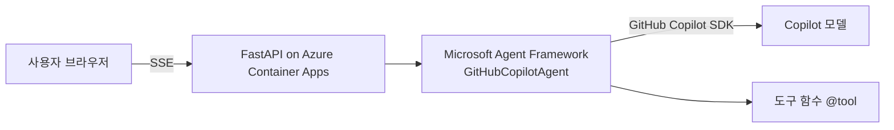

# TRD — (서비스 이름)

## 1. 아키텍처

## 2. 기술 스택
| 영역 | 선택 | 이유 |
|---|---|---|
| 모델 연결 | GitHub Copilot SDK (`github-copilot-sdk`) | 필수 기술 |
| 에이전트 | Microsoft Agent Framework (`agent-framework-github-copilot`) | 필수 기술, 도구 호출·스트리밍 |
| 백엔드 | Python 3.12, FastAPI | 비동기 스트리밍 |
| 프런트 | 정적 HTML/JS (반응형) | 단순함 |
| 배포 | Azure Container Apps | 컨테이너 1개로 반복 배포 |

## 3. API
| Method | Path | 설명 |
|---|---|---|
| GET | `/api/health` | 헬스 체크 |
| POST | `/api/chat` | `{message}` → SSE `{text}` / `{error}` / `{done}` |

## 4. 에이전트 설계
- 지시문: `app/agent.py` `INSTRUCTIONS`
- 도구: TODO (함수명, 입력, 출력, 승인 필요 여부)

## 5. 보안·운영
- 비밀 정보: `GITHUB_TOKEN`은 Container Apps secret으로만 주입, 저장소에 커밋 금지
- 입력 길이 제한(2000자), 오류 시 사용자에게 일반 메시지만 노출
- 로그: Container Apps 로그(Log Analytics)
