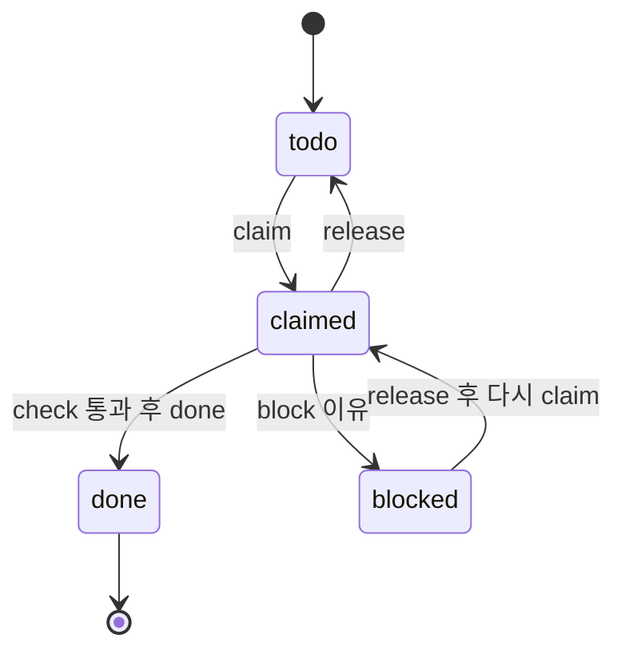

# SDD — 단계별 명세 주도 개발

동행노트를 여러 코딩 에이전트가 동시에, 자동 루프로 만들기 위한 작업 명세다. 각 에이전트(이하 워커)는 태스크 하나를 맡아 명세 → 테스트 → 구현 → 검증 순서로 끝내고 다음 태스크로 넘어간다. 워커끼리 대화하지 않아도 충돌하지 않도록, 파일 소유·계약·검증 명령을 태스크 문서에 고정한다.

## 1. 문서 우선순위

충돌하면 위가 이긴다.

1. `PRD.md` — 무엇을 만드는가(기능 F1~F14, 성공 지표)
2. `TRD.md` — 어떻게 만드는가(기술 설계)
3. 아키텍처 스파인(`_bmad-output/planning-artifacts/architecture/.../ARCHITECTURE-SPINE.md`) — 모듈을 나눠 만들 때 어긋나면 안 되는 규칙(AD-1~AD-16)
4. `docs/sdd/tasks/Txx-*.md` — 태스크 하나의 범위, 소유 파일, 계약, 수용 기준
5. `SPEC.md` — 요약본. 구현 근거로 쓰지 않는다

태스크 문서는 위 문서를 옮겨 적지 않고 절 번호로 가리킨다. 태스크 문서와 TRD가 다르면 작업을 멈추고 계약 변경 요청(4절)을 낸다.

## 2. 디렉터리

| 경로 | 내용 |
|---|---|
| `docs/sdd/README.md` | 이 문서: 규칙과 상태 |
| `docs/sdd/SPRINTS.md` | 스프린트, 게이트, 우선순위, 의존 그래프 |
| `docs/sdd/LOOP.md` | 워커·오케스트레이터 루프 지시문(그대로 붙여 넣어 쓴다) |
| `docs/sdd/tasks/` | 태스크 명세 25개(T00~T24) |
| `docs/sdd/requests/` | 계약 변경 요청. 파일 하나 = 요청 하나 |
| `scripts/sdd.py` | 태스크 조회·선점·검증·완료 처리 |

## 3. 충돌 방지 규칙

워커는 아래 일곱 가지를 어기지 않는다. `scripts/sdd.py`가 1·2·5를 기계적으로 막는다.

1. **파일 단독 소유.** 태스크 문서 frontmatter의 `owns`에 있는 파일만 만들고 고친다. 디렉터리는 `/`로 끝나게 적고 그 아래 전부를 뜻한다. 같은 파일을 가진 두 태스크는 의존 관계로 순서가 정해져 있어 동시에 진행되지 않는다(소유권은 의존 간선을 따라 넘어간다).
2. **선점 후 작업.** `python scripts/sdd.py claim Txx`가 성공해야 시작한다. 선점은 `owns` 파일을 잠근다. 다른 진행 중 태스크와 파일이 겹치거나 의존 태스크가 끝나지 않았으면 선점이 거부된다.
3. **계약 먼저.** 모든 모듈 파일은 T00이 시그니처와 `NotImplementedError` 본문으로 먼저 만든다. 그래서 어느 태스크든 import가 깨지지 않고, 아직 구현되지 않은 의존 모듈은 테스트에서 가짜로 바꿔 쓴다.
4. **공유 타입은 고치지 않는다.** `app/schemas.py`, `app/config.py`, `requirements.txt`는 T00만 쓴다. 필드나 의존 패키지가 더 필요하면 `docs/sdd/requests/Txx-<짧은이름>.md`를 만들고 그 태스크는 `blocked`로 둔다. 요청은 오케스트레이터가 처리한다.
5. **검증 통과 후 완료.** `python scripts/sdd.py check Txx`(frontmatter `verify` 명령 실행 + 소유 파일 존재 확인)가 통과해야 `done Txx`를 할 수 있다.
6. **기능은 플래그 뒤에.** 자를 수 있는 기능(SPRINTS.md 4절)은 `config.Settings`의 플래그로 감싼다. 플래그를 켜는 것은 오케스트레이터가 게이트에서 배포 설정으로 한다. 워커는 플래그 기본값을 바꾸지 않는다. 그래서 기능을 자르는 일이 코드 수정이 아니라 설정 변경이다.
7. **흔적 금지.** 저장소 파일·주석·문서에 에이전트·도구·모델 이름, 세션 ID, 로컬 절대 경로를 쓰지 않는다(`AGENTS.md`). 워커 식별자는 선점 상태에만 남고, 그 상태는 저장소 밖(`git rev-parse --git-common-dir` 아래 `sdd-state/`)에 있다. 커밋·푸시는 하지 않는다.

## 4. 계약 변경 요청

`docs/sdd/requests/Txx-<이름>.md`에 다음 네 줄을 적는다.

```markdown
- 요청 태스크: Txx
- 바꿀 파일: app/schemas.py
- 내용: `MatchResult`에 `elapsed_ms: int | None` 추가
- 이유: 평가 화면 단계별 시간(F10)
```

오케스트레이터는 요청을 반영한 뒤(필요하면 TRD·스파인도 같이) 요청 파일을 지우고 `python scripts/sdd.py release Txx`로 막힌 태스크를 풀어 준다.

## 5. 작업 모드

- **기본: 한 작업 트리 공유.** 모든 워커가 같은 작업 트리에서 서로 다른 파일만 고친다. 커밋하지 않아도 앞 태스크의 결과를 바로 import할 수 있다. 커밋은 사람이 게이트마다 한다.
- **선택: 워크트리 분리.** 워커마다 워크트리를 두는 경우에도 선점 상태는 공통 git 디렉터리에 있어 공유된다. 다만 앞 태스크의 결과를 보려면 사람이 합쳐 줘야 하므로, 의존 태스크가 끝날 때마다 합치는 비용이 든다. 해커톤 일정에서는 기본 모드를 쓴다.

## 6. 태스크 상태

`todo` → `claimed` → `done`. 막히면 `blocked`(이유 기록), 풀리면 다시 `claimed`. 포기하면 `release`로 `todo`가 된다. 상태는 `python scripts/sdd.py list`로 본다.



## 7. 태스크 문서 형식

```markdown
---
id: T03
title: 자격 규칙과 제도 데이터
sprint: S1
priority: P0          # P0 필수 경로, P1 MAF 깊이, P2 입력 확장, P3 선택
cut_rank: 0           # 0 자르지 않음. 1이 가장 먼저 잘린다(SPRINTS.md 4절)
deps: [T00]
owns: [app/rules.py, data/schemes.json, tests/test_rules.py]
verify: ["python -m pytest -q tests/test_rules.py"]
features: [F4, F5, F6]
flag: null            # 감싸는 기능 플래그
---
```

본문 절: 목표 / 근거 / 계약 / 동작 / 수용 기준 / 하지 않는 것. 수용 기준은 모두 테스트나 명령으로 확인할 수 있게 쓴다.
