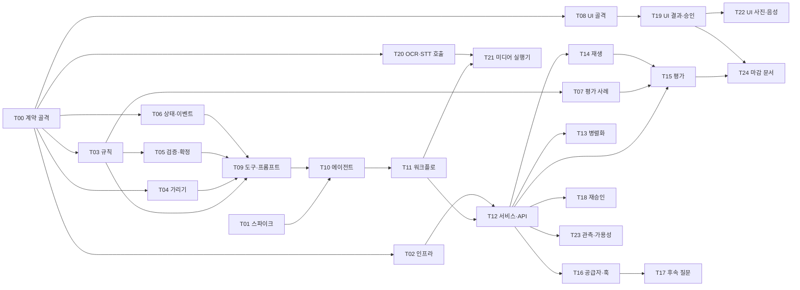

# 스프린트 계획

2026-11-05 KST 기준. 1차 제출 15:10, 최종 제출 16:20. 이 문서가 TRD 10절의 구현 순서·일정을 대신한다(TRD 10절은 이 문서를 가리킨다).

## 1. 원칙

- **필수 경로 먼저.** F1~F8, F10, F11(P0)이 배포된 앱에서 통과하는 것이 최우선이다.
- **자르는 순서의 역순으로 만든다.** 남는 워커는 `cut_rank`가 큰(나중에 잘리는) 태스크부터 가져간다. 그래서 시간이 모자라 잘리는 것은 항상 가장 덜 중요한 기능이다.
- **게이트에서만 기능을 켠다.** 워커는 플래그 뒤에서 만들고, 오케스트레이터가 게이트에서 검증한 뒤 배포 설정으로 켠다.
- **선점 규칙이 순서를 지킨다.** 태스크를 고르는 순서는 `python scripts/sdd.py ready`가 정한다: 의존이 끝난 태스크 중 `priority` 오름차순(P0 먼저), 같으면 `cut_rank` 내림차순, 같으면 ID 순.

## 2. 스프린트와 게이트

| 스프린트 | 시간 | 목표 | 태스크 | 끝 게이트 |
|---|---|---|---|---|
| S0 계약 | 14:00–14:15 | 모든 모듈의 시그니처 고정, 라이브러리 동작 확인, 인프라 착수 | T00, T01, T02 | **G0** |
| S1 순수 코어 | 14:15–14:45 | 순수 함수·상태·데이터·UI 골격을 병렬로 | T03, T04, T05, T06, T07, T08, (여유: T20) | — |
| S2 직렬 통합 | 14:45–15:10 | 텍스트 입력, 매칭 직렬로 F1~F8을 배포 앱에서 통과 | T09, T10, T11, T12, T19 | **G1 = 1차 제출** |
| S3 필수 마감·MAF 깊이 | 15:10–15:40 | 재생·평가(필수), 병렬화·공급자·훅·후속 질문·재승인 | T14, T15, T13, T16, T17, T18 | **G2** |
| S4 입력 확장 | 15:40–16:00 | 사진·음성 입력과 정리 | T20, T21, T22, T23 | **G3 = 코드 동결** |
| S5 마감 | 16:00–16:20 | 지표 기록, 문서 동기화, 최종 배포 확인 | T24 | 최종 제출 |

S1·S2에서 손이 비는 워커는 `ready`가 내주는 P1·P2 태스크(예: T20 OCR·STT 호출, 의존이 T00뿐)를 먼저 가져가도 된다. 필수 경로 태스크가 `ready`에 나오면 그것이 항상 먼저다.

### 게이트 확인 항목

| 게이트 | 확인(오케스트레이터) | 통과 못 하면 |
|---|---|---|
| G0 (14:15) | T00 `check` 통과(모든 모듈 import 가능, `pytest -q` 수집 성공). T01 결과가 `docs/eval-result.md` 1절에 있고 스파인 Open Questions 6개에 답이 있다. 빈 앱 `/healthz`가 공개 URL에서 200 | T01의 실패 대안을 TRD·스파인에 반영하고 해당 태스크 문서를 고친 뒤 S1 시작 |
| G1 (15:10) | `pytest -q` 전체 통과. 배포 URL에서 사례 1 텍스트 실행이 라이브로 `approval_required`까지 가고 승인 시 `finalized`. 거부 시 `approval_kept` 또는 `drafted`. 1차 제출 | 실패 단계를 재생 없이 고칠 수 있으면 15:20까지 고친다. 아니면 S3의 P1 태스크를 미루고 워커 전원을 필수 경로에 둔다 |
| G2 (15:40) | 재생(F11)·평가(F10)가 배포 앱에서 동작. 끝난 P1 태스크의 플래그를 켜고 재배포 후 사례 1 재확인 | 켠 플래그가 회귀를 내면 그 플래그만 끈다 |
| G3 (16:00) | 끝난 P2·P3 태스크 플래그를 켜고 재배포, 사례 1·2·4 확인. 이후 코드 수정 금지(문서만) | 사진·음성 경로가 통과하지 않으면 해당 플래그를 끈다. 둘 다 끄면 `enableAiServices=false`로 재배포한다 |
| 최종 (16:20) | T24 완료, 배포 URL에서 사례 1 라이브 통과 재확인. 이후 재배포 금지 | — |

## 3. 태스크 의존 그래프

정확한 의존은 각 태스크 frontmatter의 `deps`가 원본이다. 그래프와 다르면 frontmatter를 따른다.

## 4. 기능 플래그와 자르는 순서

`cut_rank` 1이 가장 먼저 잘린다. 플래그 기본값은 모두 꺼짐이고, 오케스트레이터가 게이트에서 Container App 환경변수(Bicep 매개변수)로 켠다. 이 표는 TRD 10절의 자르는 순서와 같다.

| cut_rank | 기능 | 플래그 | 태스크 | 꺼졌을 때 동작 |
|---:|---|---|---|---|
| 1 | Application Insights 가용성 테스트 | Bicep `enableAvailabilityTest` | T23 | 리소스를 만들지 않는다 |
| 2 | 브라우저 녹음 | `ENABLE_BROWSER_RECORDING` | T22 | 음성 탭에 파일 올리기만 보인다 |
| 3 | STT 화자 분리 | `STT_DIARIZATION` | T20 | 화자 구분 없이 전사한다 |
| 4 | F13 음성 입력 | `ENABLE_AUDIO_INPUT` | T20, T21, T22 | 음성 탭을 숨기고 사례 4는 대본 텍스트로 실행한다 |
| 5 | F12 사진 입력·F14 정리 | `ENABLE_IMAGE_INPUT` | T20, T21, T22 | 사진 탭을 숨기고 사례 2는 메모 텍스트로 실행한다 |
| 6 | 거부 뒤 재승인 | `ENABLE_REAPPROVAL` | T18 | 거부하면 `drafted`로 끝난다 |
| 7 | F9 후속 질문 | `ENABLE_ASK` | T17 | 칩을 숨기고 `/ask`는 409 |
| 8 | 세션 훅 2개 | `ENABLE_SESSION_HOOKS` | T16 | 관측 span 속성만 빠진다(감사 기록·규칙 7은 영향 없음) |
| 9 | `VerifiedDecisionsProvider` | `ENABLE_CONTEXT_PROVIDER` | T16 | Documenter 프롬프트에 판정 목록을 직접 넣는다 |
| 10 | 매칭 병렬화 | `MATCH_PARALLEL` | T13 | 매칭 3개를 직렬 간선으로 잇는다 |
| — | Azure AI Services 전체 | `ENABLE_AI_SERVICES`, Bicep `enableAiServices` | T02, T20 | 4·5가 모두 꺼지면 함께 끈다(쓰지 않는 서비스를 남기지 않는다) |

F1~F8, F10, F11은 플래그가 없고 자르지 않는다.

## 5. 역할

- **오케스트레이터(1명, 사람 권장):** 게이트 확인, 플래그 켜기, `azd up` 배포, 계약 변경 요청 처리, 게이트마다 커밋. `LOOP.md` 2절.
- **워커(여러 명):** `LOOP.md` 1절 루프를 돈다. 배포·커밋·플래그 변경을 하지 않는다.
- **사람 전용 작업:** T07의 손글씨 메모 촬영과 녹음(13:45–14:30, TRD 3.9), T02·T23의 Azure 구독 로그인과 토큰 입력, T24의 스톱워치 측정(PRD 5절).

## 6. 시간 초과 처리

- 태스크 하나가 스프린트 끝을 넘기면 워커는 `block`으로 이유를 남기고 다음 태스크로 간다. 오케스트레이터는 그 태스크를 범위 축소(태스크 문서 "하지 않는 것"에 추가)하거나 플래그를 끈 채로 둔다.
- P0 태스크가 막히면 오케스트레이터가 그 태스크에 워커를 하나 더 붙이지 않는다(파일 단독 소유). 대신 막힌 원인을 계약 변경 요청으로 풀거나 직접 고친다.
